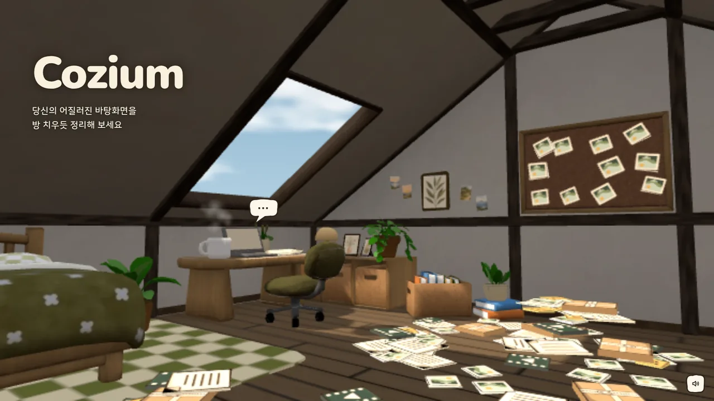
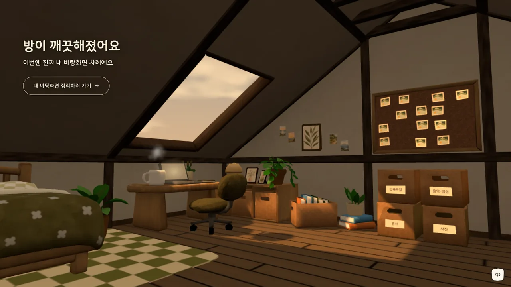
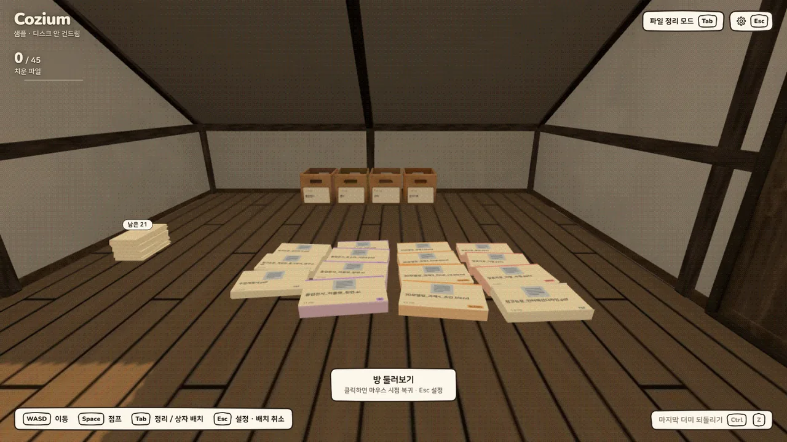

# Cozium

> 흩어진 하루가 제자리를 찾는 곳.

Cozium은 바탕화면의 파일을 다락방 바닥에 쏟아 놓고, 손으로 집어 폴더 상자에 담으며 정리하는 웹 게임(수업 과제 시제품)입니다. 랜딩에서 어질러진 아침 다락방의 노트북 속으로 들어가 정리의 감각을 먼저 겪고, 정리된 방에서 노트북으로 걸어 들어가 정리방(3D 1인칭)을 엽니다.

| 랜딩: 어질러진 아침 다락방 | 랜딩: 정리된 방 | 정리방 |
| --- | --- | --- |
|  |  |  |

## 빠르게 실행하기

Node.js 20 이상이 필요합니다. 외부 패키지 의존성이 없고 Three.js(r185)와 서체를 저장소에 포함하므로 `npm install`과 빌드가 필요 없습니다.

```bash
npm run dev
```

브라우저에서 [http://localhost:5173/](http://localhost:5173/)을 엽니다. HTML 파일을 직접 열면 모듈·모델을 못 읽으므로 제공된 서버를 쓰세요. 데스크톱 Chrome·Edge 기준입니다.

| 주소 | 용도 |
| --- | --- |
| `/` | 랜딩: 노트북 → 「나의 바탕화면」 환영 → 아침 다락방 → 「정리 시작해볼까요?」 → 노트북 속 바탕화면이 바닥·상자가 됨 → 직접 담기 → 정리된 방 → 「내 바탕화면 정리하러 가기」 (흐름 설명은 `js/landing-story/story.js` 맨 위) |
| `/#end` | 랜딩 마지막 장면(정리된 방)에서 바로 시작. 정리방에서 뒤로 가기를 하면 여기로 옴 |
| `/?render=high` · `/?render=low` | 랜딩 화질 고정(기본은 자동) |
| `/help.html` | 이용 안내: 시작 방법, 파일과 개인정보, 조작법, 자주 묻는 질문 |
| `/app.html` | 정리방: 가져오기 화면 = 랜딩에서 들어간 노트북 바탕화면(놓으면 아이콘으로 깔리고 ‘방으로 가기’) |
| `/app.html?entry=sample&storage=memory` | 샘플 파일로 정리방 바로 시작 (`&intro=0`이면 조작 안내 화면도 건너뜀) |
| `/app.html?…&quality=high` · `quality=low` | 정리방 화질 고정 |

`landing.html` 주소는 랜딩으로, `index.html?entry=…` 같은 예전 앱 주소와 Helper가 붙여 주는 `#helper=…` 주소는 `app.html`로 넘어갑니다(`js/entry-route.js`).

## 파일은 어떻게 다루나요?

| 모드 | 가져오는 항목 | 파일 이동·새 폴더·되돌리기 |
| --- | --- | --- |
| 샘플 체험 | 프로젝트의 가상 파일 | 메모리에서만 반영 |
| 웹 체험 (`WebDropProvider`) | 사용자가 직접 드롭한 파일·폴더 | **읽기 전용.** 정리 계획만 만들며 디스크는 변경하지 않음 |
| Desktop Helper (`NativeHelperProvider`) | 지정한 바탕화면 폴더를 스캔 | **실제 파일에 반영.** 로컬 Helper를 별도로 실행해야 함 |

웹 체험은 데스크톱 Chrome 또는 Edge의 파일 핸들 기능과 HTTPS 또는 localhost 환경을 사용합니다. 정리할 파일과 목적지 폴더를 골라 가져오기 영역에 드롭합니다. 웹페이지가 바탕화면 전체를 자동으로 읽지는 않습니다.

Helper는 바탕화면 범위 안에서 파일을 옮기고 새 폴더를 만들며 이동을 되돌립니다. 삭제 API가 없고 동명 파일을 덮어쓰지 않으며, 되돌릴 때도 이동한 파일의 정체를 확인합니다.

**연결(v0.2.3):** 정리방 가져오기 화면의 Helper 창이나 결과 화면의 「Helper로 적용」을 열어 둔 채 `CoziumHelper.exe`를 실행하면, 페이지가 고정 포트 47821에서 Helper를 찾아 저절로 붙습니다(`GET /v1/pair`는 허용된 사이트에만 토큰을 줌). 5초 안에 붙는 탭이 없으면 Helper가 브라우저를 직접 엽니다. 포트·토큰을 손으로 넣는 칸도 접어 두었습니다.

테스트할 때는 반드시 더미 폴더를 지정하세요. 개발 서버는 다른 터미널에서 계속 켜 둡니다.

```bash
node helper/desktop-helper.mjs --dev --app http://localhost:5173/app.html --desktop "<테스트 폴더의 절대 경로>"
```

옵션과 파일 작업 범위는 [Helper README](helper/README.md)에 있습니다.

## 지금 구현된 것

- **랜딩 (`js/landing-story/`):** 사용자가 Blender로 만든 다락방(`models/room.glb`)이 처음과 끝입니다. 어두운 방 책상 위 노트북 하나 → 노트북을 누르면 「나의 바탕화면 / 환영합니다」 → 깨끗한 바탕화면에서 뒤로 빠지며 파일이 널린 아침 다락방 + Cozium → 노트북 위 연필 말풍선을 누르면 파일이 노트북으로 빨려 들어가고 카메라도 따라 들어감 → 어질러진 바탕화면이 바닥·상자가 되고 방문자가 직접 더미를 상자에 담음 → 정리된 바탕화면 → 정리된 방. 「내 바탕화면 정리하러 가기」나 노트북을 누르면 노트북으로 걸어 들어가 `app.html`로 넘어가고, 뒤로 가기는 정리된 방(`#end`)으로 돌아옵니다. 노트북으로 들어가는 길은 실제 카메라 이동이고, 화면이 커질 때만 노트북 화면에 바탕화면 DOM이 겹칩니다.
- **정리방:** 같은 다락방에서 1인칭으로 걷습니다. 사진·txt·md는 벽 코르크 보드, 나머지는 시작 자리 앞 바닥에서 시작합니다. 폴더는 처마 벽을 따라 놓인 상자(`models/box.glb`, 20개까지)이고, 두 단까지 쌓입니다. 집기·여러 장 담기·상자에 넣기·던지기·되돌리기·하위 폴더 열기·새 폴더·상자 배치(Tab)·점프(Space)·침대로 낮 ↔ 밤. 빈손으로 노트북을 누르면 노트북 화면 속으로 들어가 결과(정리된 바탕화면)를 봅니다.
- **소리 (`js/sound.js`, 2026-11-09):** 배경음악은 다락방이 보일 때만 나오고, 노트북 속(바탕화면·바닥 체험·가져오기·결과 화면)으로 들어가면 페이드 아웃, 방으로 나오면 멈춘 자리부터 페이드 인합니다. 곡은 이음매 없이 반복되도록 박자에 맞춰 반복 구간을 잘랐습니다(원본 파일 그대로). 효과음(집기·상자에 넣기·던져 떨어짐·핀보드에 꽂기·단추·결과 화면 등)은 파일 없이 Web Audio로 그 자리에서 합성합니다. 브라우저는 첫 클릭 전엔 소리를 막으므로 첫 클릭에 오디오를 깨우고 음악(약 2.1 MB)을 받습니다. 끄기는 랜딩 오른쪽 아래·정리방 설정(Esc) 창, 끈 상태는 이 브라우저에 기억합니다.
- **그림:** 툰 3단 재질, 주변색 외곽선 1px, 디더링(Fine), PS1 정점 흔들림(Wobble). 랜딩과 정리방이 같은 효과 코드(`js/three/outline-effect.js`, `vertex-snap.js`)를 씁니다.
- **기기별 화질 (`js/three/render-quality.js`):** 자동이 기본입니다. GPU 이름과 코어·메모리로 처음 단계를 짐작하고(외장 그래픽 high, 내장 balanced, 소프트웨어 GL low), 실제 프레임이 43fps 아래로 떨어지면 먼저 해상도를 12.5%씩 낮추고, 그래도 느리면 한 단계 아래로 내려갑니다. 단계가 내려가면 그림자 해상도·갱신 빈도 → 햇살 줄기 → 외곽선·디더링 순서로 빠집니다. 랜딩의 방은 움직이지 않으므로 그림자는 빛이 바뀔 때만 다시 그립니다.

가져오기 화면은 랜딩에서 들어간 노트북 바탕화면입니다(2026-10-18). 바탕화면에서 Ctrl+A로 고른 항목을 화면 아무 데나 놓으면 아이콘으로 깔리고, ‘방으로 가기’를 누르면 아이콘이 떨어지며 다락방이 열립니다. 자동 분류는 하지 않습니다. 어떤 파일을 어디에 넣을지는 사용자가 정합니다.

## 기본 조작

**랜딩:** 노트북을 누르면 시작하고, 말풍선 「정리 시작해볼까요?」를 누르면 이야기가 저절로 흐릅니다. 노트북 속 바닥에서는 파일 더미를 누르면(또는 누른 채 훑으면) 손에 모이고, 상자를 누르거나 상자 위에서 놓으면 들어갑니다. Enter를 누르면 더미 하나를 대신 넣어 줍니다. 오른쪽 위 「건너뛰고 바로 시작 →」은 이야기 도중에만 보입니다. 동작 줄이기 설정에서는 카메라 이동 없이 장면이 바뀌고, WebGL이 없으면 정지 이미지와 시작 버튼만 보입니다.

**정리방:** 들어가면 먼저 로딩 화면(방 모델·상자·셰이더 준비 막대)이 뜨고, 다 되면 조작 안내가 나옵니다. ‘방에 들어가기’(또는 Enter)를 누르면 시점을 잡습니다. **Esc는 설정 창**입니다 — 화면 품질·그림 효과·조작 표와 함께 새 폴더·기록(정리 계획·한 일)·소리 켜기/끄기가 여기 있고, 창을 클릭으로 닫으면 바로 시점이 다시 잡힙니다. 위에는 「파일 정리 모드 Tab」과 「⚙ Esc」 칩, 오른쪽 아래에는 「마지막 더미 되돌리기 Ctrl Z」가 있습니다. 같은 조작 표가 앱의 설정 창(`app.html` `#settings-keys`)에도 있으니 바꾸면 둘 다 고칩니다.

| 조작 | 동작 |
| --- | --- |
| 마우스 / WASD, Shift | 둘러보기(가운데 점이 손이 닿는 곳) / 걷기, 빠르게 |
| Space | 점프 (상자 하나를 넘거나 위에 올라섬) |
| 좌클릭 파일 · 누른 채 훑기 | 파일 한 개 또는 여러 개 담기 |
| 좌클릭 상자 | 들고 있는 파일 넣기 · 빈손이면 상자(폴더)가 열림 |
| 좌클릭 더미 | 다음 무더기 꺼내기 |
| 우클릭 꾹 눌렀다 떼기 | 보는 방향으로 던지기 — 오래 누를수록 멀리, 위를 보면 높이. 궤적 끝의 상자가 빛나면 그 상자에 들어감. 짧게 누르면 발 앞에 (코르크 보드를 겨누면 사진·메모를 다시 꽂음) |
| 빈손으로 침대 클릭 | 한숨 자기: 낮 ↔ 밤 |
| 빈손으로 책상 위 노트북 클릭 | 정리 끝내기 — 노트북 화면 속으로 들어가 결과 보기 (언제든. 다 치우면 노트북이 부름). 결과는 정리된 바탕화면 — 체험 모드면 여기서 Desktop Helper로 실제 바탕화면에 적용하거나 정리 계획(.json)을 저장 |
| Tab | 파일 정리 / 상자 배치 전환 (배치 중 휠: 회전, 우클릭·Esc: 취소) |
| Ctrl+Z | 마지막 작업 되돌리기 |
| Ctrl+A / Backspace | 전부 담기 / 열린 상자 닫기 |
| Esc | 설정 창 열기·닫기 |

## ⚠️ 앱이 이상하면 먼저: 보안 정책(CSP)

`app.html`에는 보안 정책(Content-Security-Policy)이 걸려 있습니다. 외부 폰트·CDN·분석 스크립트를 새로 넣거나, `app.html` 안의 importmap·인라인 스크립트를 고치면 브라우저가 막습니다. 콘솔(F12)에 "Content Security Policy" 빨간 줄이 보이면 이것 때문입니다. 고치는 법은 `CLAUDE.md` §8-9, 지문(sha256)이 맞는지는 `npm test`가 확인합니다.

## 테스트와 확인 범위

```bash
npm test
```

`tests/`, `tests/landing/`, `helper/`의 테스트를 실행합니다.

- 정리방: 가짜 파일 핸들·메모리 Provider로 가져오기, 가상 이동, 세션 상태, 충돌, 폴더 탐색, 상자 배치·회전, 다락방 배치(바닥·코르크 보드·상자 줄), 걷기 충돌·점프·던지기, 화질 단계, 정리 계획 저장·적용.
- 랜딩: preload·에셋 경로·시작 버튼 주소(`tests/landing/preload.test.mjs`). 장면 자체(WebGL)는 자동 테스트가 없어 브라우저로 확인합니다.
- 소리: 코드가 부르는 효과음 이름이 `js/sound.js`에 다 있는지, 음악 파일과 반복 구간(`tests/sound.test.js`). 소리 크기·느낌은 사람 귀로만 확인합니다.
- 보안 정책: `app.html` CSP의 importmap 지문·연결 허용 범위(`tests/csp.test.js`).
- Helper: 임시 폴더에서 동명 충돌과 동시 이동, 파일 정체 확인, 되돌리기, 경로 범위, Origin·토큰·본문 제한, 짝짓기(`/v1/pair`)가 허용 출처에만 토큰을 주는지.

2026-11-10 기준(Linux): 191개 중 190개 통과, 1개 건너뜀(Windows 경로 테스트는 Windows에서만 돌아감). 헤드리스 Chromium(소프트웨어 GL)으로 랜딩 전 장면과 정리방 플레이, 소리가 켜지고 꺼지는 때를 확인했습니다. **실제 GPU의 프레임, 포인터락 조작감, 소리를 귀로 듣는 것, 학교 PC, 모바일, 실제 바탕화면 파일 작업은 자동으로 확인되지 않습니다.** 자동 테스트 통과는 실기기 검증이 아닙니다.

## GitHub Pages 배포

정적 HTML·CSS·JavaScript입니다. 저장소 루트에 `index.html`과 `.nojekyll`이 있으므로 **Settings → Pages → Build and deployment → Deploy from a branch**에서 브랜치와 **/(root)** 를 고르면 됩니다([GitHub 안내](https://docs.github.com/en/pages/getting-started-with-github-pages/configuring-a-publishing-source-for-your-github-pages-site)). 모든 주소가 `./` 기준 상대 경로라 `/저장소이름/` 아래에서도 동작합니다.

첫 방문에 받는 큰 파일은 `models/room.glb`(약 3.0 MB, 랜딩과 정리방이 같이 씀, 브라우저 캐시로 한 번만), Three.js(약 0.75 MB), 글꼴(약 0.7 MB)입니다. 배경음악(`assets/audio/bgm.mp3`, 약 2.1 MB)은 첫 클릭 뒤에 받습니다.

Helper는 사용자의 컴퓨터에서 따로 실행합니다. 배포본은 `CoziumHelper.exe` 하나이고(Node 설치 불필요), GitHub Releases에 올립니다. 사이트의 다운로드 링크는 `https://github.com/Yeos-min/Cozium/releases/latest/download/CoziumHelper.exe`입니다. 만드는 법은 `helper/README.md`.

기본 허용 출처는 `https://yeos-min.github.io`, Helper가 여는 페이지는 `https://yeos-min.github.io/Cozium/app.html`입니다. 테스트할 때는 더미 폴더를 줍니다.

```bash
node helper/desktop-helper.mjs --desktop "<테스트 폴더의 절대 경로>"
CoziumHelper.exe --desktop "<테스트 폴더의 절대 경로>"
```

HTTPS 페이지에서 로컬 Helper(127.0.0.1)로 처음 연결할 때 Chrome 계열은 「이 기기의 다른 앱 및 서비스에 액세스」 권한을 묻습니다(허용해야 연결됨). 2026-11-07 Windows + Brave 실기기에서 저절로 연결·이동·되돌리기를 확인했습니다.

## 프로젝트 구조

```text
index.html                 랜딩 (3D 다락방)
help.html                  이용 안내
app.html                   파일 가져오기 + 3D 정리방 (CSP가 걸려 있음, 아래 ⚠️)
landing.html               예전 랜딩 주소 호환
css/
  fonts.css                글꼴 (나눔스퀘어라운드·Nunito, 모든 페이지)
  landing-story.css        랜딩
  site-nav.css             상단 내비게이션 (랜딩·이용 안내 공통)
  help.css                 이용 안내
  styles.css               정리방 바탕 (옛 규칙이 남아 있어 아래 파일들이 덮어씀)
  room-paper.css           정리방 UI의 연필 + 크림 종이 (위 칩·키 안내·설정/기록 창·소리 단추)
  onboarding.css, finish.css, folder-interior.css, room-intro.css, time-hint.css
                           가져오기 화면 / 결과 화면 / 상자 안 / 정리 시작 안내 / 조준선 위 힌트
js/
  entry-route.js           예전 주소·Helper 주소를 app.html로
  sound.js                 배경음악(방에서만) + 합성 효과음 + 켜기/끄기 (랜딩·정리방 공용)
  landing-story/           랜딩: story.js(장면·연출, 맨 위에 흐름 지도), room-layer.js(3D 방), outline-ink.js
  app.js                   Provider, 상태, UI 연결 (조립만)
  providers/               웹 읽기 전용 / Helper / 샘플
  state/                   정리 세션과 작업 이력, 정리 계획(cleanup-plan)
  ui/                      가져오기 화면, 결과 화면, 정리 시작 안내, 폴더 내부, 연필 테두리(pencil.js), 상태 표시
  three/                   정리방: 장면(scene-kit), 보드(board-3d), 다락방 숫자(attic-room), 카드·상자, 던지기, 효과, 화질(render-quality)
models/                    room.glb(다락방), box.glb(폴더 상자) — models/README.md
assets/
  fonts/                   나눔스퀘어라운드·Nunito woff2와 OFL 라이선스
  audio/bgm.mp3            배경음악 (Pixabay, 아래 라이선스)
  landing/room-3d/         랜딩 정지 이미지(로딩 중), 노트북 안 바닥
  landing/parts/desktop-v4/  노트북 바탕화면 아이콘·배경·작업표시줄·테두리 (랜딩·가져오기 화면)
  app/desk/                가져오기 화면 작업표시줄 조각(막대·앱 타일 5·트레이)
vendor/three/              Three.js r185와 MIT 라이선스
helper/                    로컬 파일 작업 서버와 테스트
tests/                     자동 테스트
tools/                     개발 서버, 테스트 실행기, D → C 올리기(sync-to-c.bat), 안 쓰는 파일 치우기(cleanup.bat), 측정 도구
docs/                      디자인 시스템, 다락방 연결 메모, 렌더 효과, 성능 기준, 타임라인
```

## 협업

작업 전에 [AGENTS.md](AGENTS.md), [CLAUDE.md](CLAUDE.md), [디자인 시스템](docs/design-system.md), [에이전트 타임라인](docs/agent-timeline.md), [성능 기준](docs/performance.md)을 읽습니다. 다락방과 게임의 연결은 [docs/attic-room.md](docs/attic-room.md), 그림 효과는 [docs/render-effects.md](docs/render-effects.md)에 있습니다.

## 에셋과 라이선스

Three.js r185는 [MIT 라이선스](vendor/three/LICENSE), 나눔스퀘어라운드·Nunito는 SIL Open Font License 1.1([나눔](assets/fonts/nanum-square-round/OFL.txt), [Nunito](assets/fonts/nunito/OFL.txt))로 포함되어 있습니다. 배경음악 `assets/audio/bgm.mp3`는 Pixabay의 dailyjoy [「Kalimba Soft Background Loop」](https://pixabay.com/music/beats-kalimba-soft-background-loop-156439/)(Pixabay 콘텐츠 라이선스)이고, 효과음은 `js/sound.js`가 Web Audio로 합성합니다. 다락방·상자 3D 모델은 사용자가 Blender로 제작했고, 바탕화면 SVG 파츠는 프로젝트 코드로 만들었습니다.

프로젝트 자체의 공개 라이선스는 아직 지정하지 않았습니다.
