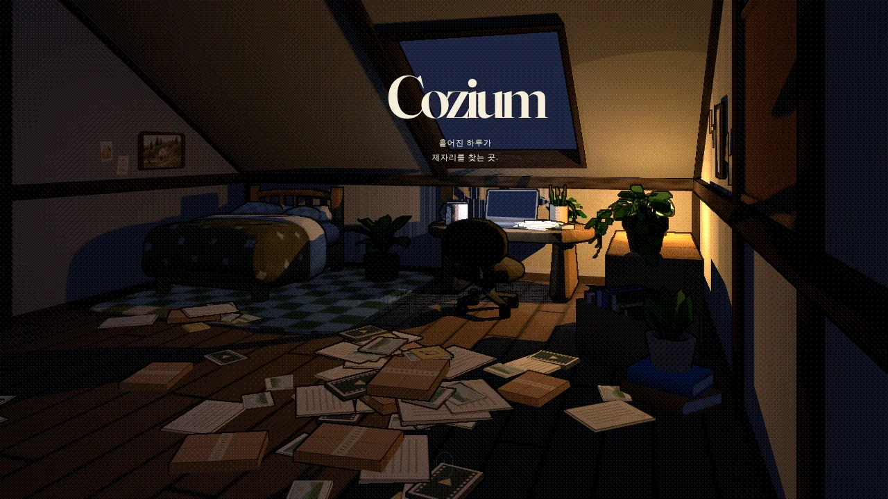
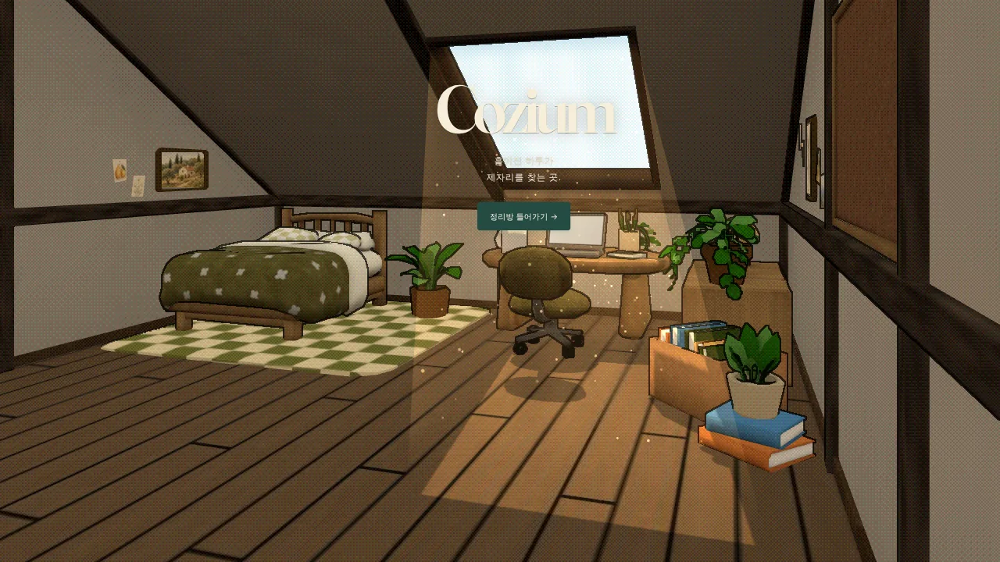
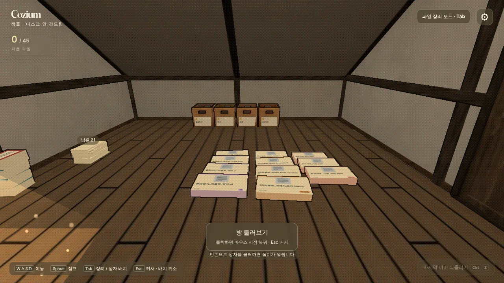

# Cozium

> 흩어진 하루가 제자리를 찾는 곳.

Cozium은 바탕화면의 파일을 다락방 바닥에 쏟아 놓고, 손으로 집어 폴더 상자에 담으며 정리하는 웹 프로토타입입니다. 랜딩에서 밤의 다락방 노트북으로 들어가 정리의 감각을 먼저 겪고, 낮이 된 정리된 방에서 정리방(3D 1인칭)으로 들어갑니다.

| 랜딩: 밤의 어질러진 방 | 랜딩: 낮의 정리된 방 | 정리방 |
| --- | --- | --- |
|  |  |  |

## 빠르게 실행하기

Node.js 20 이상이 필요합니다. 외부 패키지 의존성이 없고 Three.js(r185)와 서체를 저장소에 포함하므로 `npm install`과 빌드가 필요 없습니다.

```bash
npm run dev
```

브라우저에서 [http://localhost:5173/](http://localhost:5173/)을 엽니다. HTML 파일을 직접 열면 모듈·모델을 못 읽으므로 제공된 서버를 쓰세요. 데스크톱 Chrome·Edge 기준입니다.

| 주소 | 용도 |
| --- | --- |
| `/` | 랜딩: 밤의 방 → 노트북 안(파일은 바닥의 물건, 폴더는 상자) → 직접 담기 → 정리된 바탕화면 → 낮의 정리된 방 → ‘정리방 들어가기’ |
| `/?lab` | 랜딩 + 렌더 테스트 패널(카메라·빛·재질·외곽선·디더링·정점 흔들림) |
| `/?render=high` · `/?render=low` | 랜딩 화질 고정(기본은 자동) |
| `/help.html` | 이용 안내: 시작 방법, 파일과 개인정보, 조작법, 자주 묻는 질문 |
| `/app.html` | 정리방: 가져오기 화면 = 랜딩에서 들어간 노트북 바탕화면(놓으면 아이콘으로 깔리고 ‘방으로 가기’) |
| `/app.html?entry=sample&storage=memory` | 샘플 파일로 정리방 바로 시작 |
| `/app.html?…&quality=high` · `quality=low` | 정리방 화질 고정 |

`landing.html`과 예전 `docs/landing-direction-v3/landing-direction.html` 주소는 랜딩으로, `index.html?entry=…` 같은 예전 앱 주소는 `app.html`로 넘어갑니다.

## 파일은 어떻게 다루나요?

| 모드 | 가져오는 항목 | 파일 이동·새 폴더·되돌리기 |
| --- | --- | --- |
| 샘플 체험 | 프로젝트의 가상 파일 | 메모리에서만 반영 |
| 웹 체험 (`WebDropProvider`) | 사용자가 직접 드롭한 파일·폴더 | **읽기 전용.** 정리 계획만 만들며 디스크는 변경하지 않음 |
| Desktop Helper (`NativeHelperProvider`) | 지정한 바탕화면 폴더를 스캔 | **실제 파일에 반영.** 로컬 Helper를 별도로 실행해야 함 |

웹 체험은 데스크톱 Chrome 또는 Edge의 파일 핸들 기능과 HTTPS 또는 localhost 환경을 사용합니다. 정리할 파일과 목적지 폴더를 골라 가져오기 영역에 드롭합니다. 웹페이지가 바탕화면 전체를 자동으로 읽지는 않습니다.

Helper는 바탕화면 범위 안에서 파일을 옮기고 새 폴더를 만들며 이동을 되돌립니다. 삭제 API가 없고 동명 파일을 덮어쓰지 않으며, 되돌릴 때도 이동한 파일의 정체를 확인합니다. 테스트할 때는 반드시 더미 폴더를 지정하세요. 개발 서버는 다른 터미널에서 계속 켜 둡니다.

```bash
node helper/desktop-helper.mjs --dev --app http://localhost:5173/app.html --desktop "<테스트 폴더의 절대 경로>"
```

옵션과 파일 작업 범위는 [Helper README](helper/README.md)에 있습니다.

## 지금 구현된 것

- **랜딩 (2026-10-11 3D 다락방):** 사용자가 Blender로 만든 다락방(`models/room.glb`)이 첫 장면과 마지막 장면입니다. 어질러진 방은 밤(스탠드 불빛), 정리된 방은 낮(천창 햇살 줄기). 노트북으로 들어가는 길은 실제 카메라 이동이고, 노트북 화면에는 바탕화면 DOM이 투영됩니다. 마지막 버튼을 누르면 정리된 노트북으로 걸어 들어가 `app.html`로 넘어가며, 뒤로 가기는 정리된 방으로 돌아옵니다.
- **정리방:** 같은 다락방에서 1인칭으로 걷습니다. 사진·txt·md는 벽 코르크 보드, pdf·docx·hwp는 책 더미, 나머지는 시작 자리 앞 바닥에서 시작합니다. 폴더는 침대 반대쪽 처마 벽을 따라 놓인 상자(`models/box.glb`)이고, 두 단까지 쌓입니다. 집기·여러 장 담기·상자에 넣기·되돌리기·하위 폴더 열기·새 폴더·상자 배치(Tab)·점프(Space).
- **그림:** 툰 3단 재질, 주변색 외곽선 1px, 디더링(Fine), PS1 정점 흔들림(Wobble). 랜딩과 정리방이 같은 효과 코드(`js/three/outline-effect.js`, `vertex-snap.js`)를 씁니다.
- **기기별 화질 (`js/three/render-quality.js`):** 자동이 기본입니다. GPU 이름과 코어·메모리로 처음 단계를 짐작하고(외장 그래픽 high, 내장 balanced, 소프트웨어 GL low), 실제 프레임이 43fps 아래로 떨어지면 먼저 해상도를 12.5%씩 낮추고, 그래도 느리면 한 단계 아래로 내려갑니다. 단계가 내려가면 그림자 해상도·갱신 빈도 → 햇살 줄기 → 외곽선·디더링 순서로 빠집니다. 랜딩의 방은 움직이지 않으므로 그림자는 빛이 바뀔 때만 다시 그립니다.

가져오기 화면은 랜딩에서 들어간 노트북 바탕화면입니다(2026-10-18). 바탕화면에서 Ctrl+A로 고른 항목을 화면 아무 데나 놓으면 아이콘으로 깔리고, ‘방으로 가기’를 누르면 아이콘이 떨어지며 다락방이 열립니다. 자동 분류는 하지 않습니다. 어떤 파일을 어디에 넣을지는 사용자가 정합니다.

## 기본 조작

**랜딩:** 휠·스와이프·방향키(↓/Space, ↑) 한 번에 다음(이전) 장면까지 재생됩니다. 노트북 안에서 바닥의 파일 더미를 클릭하면 손에 모이고, 상자를 클릭하면 들어갑니다. 동작 줄이기 설정에서는 카메라 이동 없이 장면이 바뀝니다. WebGL이 없으면 첫 방과 시작 버튼만 보입니다.

**정리방:** 들어가면 먼저 로딩 화면(방 모델·상자·셰이더 준비 막대)이 뜨고, 다 되면 방이 어둡게 비치는 위로 조작 안내가 나옵니다. ‘방에 들어가기’(또는 Enter)를 누르면 시점을 잡고, Esc로 마우스를 놓습니다. `?intro=0`이면 이 화면을 건너뜁니다.

| 조작 | 동작 |
| --- | --- |
| 마우스 / WASD·방향키, Shift | 둘러보기 / 이동, 빠르게 |
| Space | 점프 (상자 하나를 넘거나 위에 올라섬) |
| 파일 클릭 · 누른 채 훑기 | 파일 한 개 또는 여러 개 집기 |
| 폴더 상자 클릭 | 들고 있는 파일 넣기 (상자는 한 번에 20개까지) |
| 빈손으로 상자 클릭 | 폴더 열기 |
| 빈손으로 침대 클릭 | 낮 ↔ 밤 |
| 우클릭 꾹 눌렀다 떼기 | 보는 방향으로 던지기 — 오래 누를수록 멀리, 위를 보면 높이. 궤적 끝의 상자가 빛나면 그 상자에 들어감. 짧게 누르면 발 앞에 (코르크 보드를 겨누면 사진·메모를 다시 꽂음) |
| Ctrl+Z | 마지막 작업 되돌리기 |
| Tab | 파일 정리 / 상자 배치 전환 (배치 중 휠: 회전) |
| 오른쪽 위 「정리 끝내기」 | 언제든 끝내고 결과 보기 (다 치우면 자동). 결과는 정리된 바탕화면 — 체험 모드면 여기서 Desktop Helper로 실제 바탕화면에 적용하거나 정리 계획(.json)을 저장 |

## 테스트와 확인 범위

```bash
npm test
```

`tests/`, `tests/landing/`, `helper/`의 테스트를 실행합니다.

- 정리방: 가짜 파일 핸들·메모리 Provider로 가져오기, 가상 이동, 세션 상태, 충돌, 폴더 탐색, 상자 배치·회전, 다락방 배치(바닥·코르크 보드·책 더미·상자 줄), 걷기 충돌·점프, 화질 단계.
- 랜딩: preload·에셋 경로·시작 버튼 주소(`tests/landing/preload.test.mjs`). 장면 자체(WebGL)는 자동 테스트가 없어 브라우저로 확인합니다.
- Helper: 임시 폴더에서 동명 충돌과 동시 이동, 파일 정체 확인, 되돌리기, 경로 범위, Origin·토큰·본문 제한.

2026-10-11 기준(Linux): 166개 중 165개 통과. 실패 1개는 Windows 경로를 쓰는 Helper 테스트로 Linux에서만 실패합니다. 헤드리스 Chromium(소프트웨어 GL)으로 랜딩 전 장면과 정리방 플레이를 확인했습니다. **실제 GPU의 프레임, 포인터락 조작감, 학교 PC, 모바일, 실제 바탕화면 파일 작업은 미확인입니다.** 자동 테스트 통과는 실기기 검증이 아닙니다.

## GitHub Pages 배포

정적 HTML·CSS·JavaScript입니다. 저장소 루트에 `index.html`과 `.nojekyll`이 있으므로 **Settings → Pages → Build and deployment → Deploy from a branch**에서 브랜치와 **/(root)** 를 고르면 됩니다([GitHub 안내](https://docs.github.com/en/pages/getting-started-with-github-pages/configuring-a-publishing-source-for-your-github-pages-site)). 모든 주소가 `./` 기준 상대 경로라 `/저장소이름/` 아래에서도 동작합니다.

첫 방문에 받는 큰 파일은 `models/room.glb`(약 3.1 MB, 랜딩과 정리방이 같이 씀, 브라우저 캐시로 한 번만)와 Three.js(약 0.75 MB)입니다.

Helper는 사용자의 컴퓨터에서 따로 실행합니다. 배포 주소를 쓸 때는 `OWNER`, `REPOSITORY`를 실제 값으로 바꿉니다.

```bash
node helper/desktop-helper.mjs --origin https://OWNER.github.io --app https://OWNER.github.io/REPOSITORY/app.html --desktop "<테스트 폴더의 절대 경로>"
```

HTTPS 페이지와 로컬 Helper 사이의 연결 허용 방식은 브라우저·환경에 따라 실기기 확인이 필요합니다.

## 프로젝트 구조

```text
index.html                 랜딩 (3D 다락방)
help.html                  이용 안내
app.html                   파일 가져오기 + 3D 정리방
landing.html               예전 랜딩 주소 호환
css/
  landing-story.css        랜딩
  site-nav.css             상단 내비게이션 (랜딩·이용 안내 공통)
  help.css                 이용 안내
  styles.css, onboarding.css, folder-interior.css   정리방
js/
  landing-story/           랜딩: story.js(장면·연출), room-layer.js(3D 방), render-lab.js(?lab 패널), outline-ink.js
  app.js                   Provider, 상태, UI 연결
  providers/               웹 읽기 전용 / Helper / 샘플
  state/                   정리 세션과 작업 이력
  ui/                      가져오기 화면, 바닥 배치, 폴더 내부, 상태 표시
  three/                   정리방: 장면(scene-kit), 다락방 숫자(attic-room), 카드·상자, 효과, 화질(render-quality)
models/                    room.glb(다락방), box.glb(폴더 상자) — models/README.md
assets/landing/
  room-3d/                 랜딩 정지 이미지(로딩 중), 노트북 안 바닥
  parts/desktop-v4/        노트북 바탕화면 아이콘·배경·작업표시줄·테두리 (랜딩·가져오기 화면)
  parts/room-v3/           옛 가져오기 화면 그림(10-18부터 안 씀, GitHub에 안 올림)
  fonts/                   Fraunces 서체와 OFL
assets/app/desk/           가져오기 화면 작업표시줄 조각(막대·앱 타일 5·트레이)
vendor/three/              Three.js r185와 MIT 라이선스
helper/                    로컬 파일 작업 서버와 테스트
tests/                     자동 테스트
tools/                     개발 서버, 테스트 실행기, 정리 스크립트(archive-unused.ps1), 측정 도구
docs/                      디자인 시스템, 다락방 연결 메모, 렌더 효과, 성능 기준, 타임라인
```

## 협업

작업 전에 [AGENTS.md](AGENTS.md), [CLAUDE.md](CLAUDE.md), [디자인 시스템](docs/design-system.md), [에이전트 타임라인](docs/agent-timeline.md), [성능 기준](docs/performance.md)을 읽습니다. 다락방과 게임의 연결은 [docs/attic-room.md](docs/attic-room.md), 그림 효과는 [docs/render-effects.md](docs/render-effects.md)에 있습니다.

## 에셋과 라이선스

Three.js r185는 [MIT 라이선스](vendor/three/LICENSE), Fraunces는 [SIL Open Font License 1.1](assets/landing/fonts/OFL.txt)로 포함되어 있습니다. 다락방·상자 3D 모델은 사용자가 Blender로 제작했고, 바탕화면 SVG 파츠는 프로젝트 코드로 만들었습니다.

프로젝트 자체의 공개 라이선스는 아직 지정하지 않았습니다.
