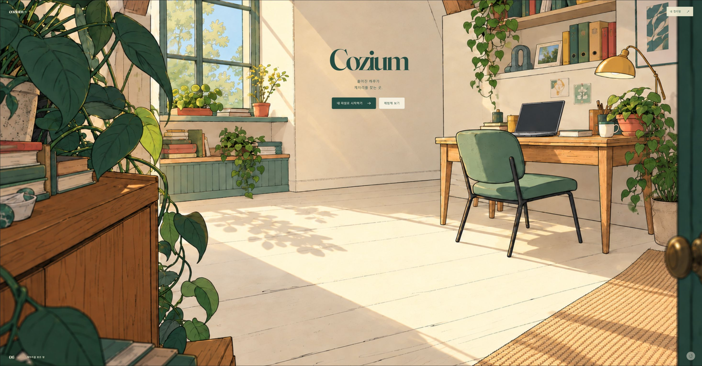
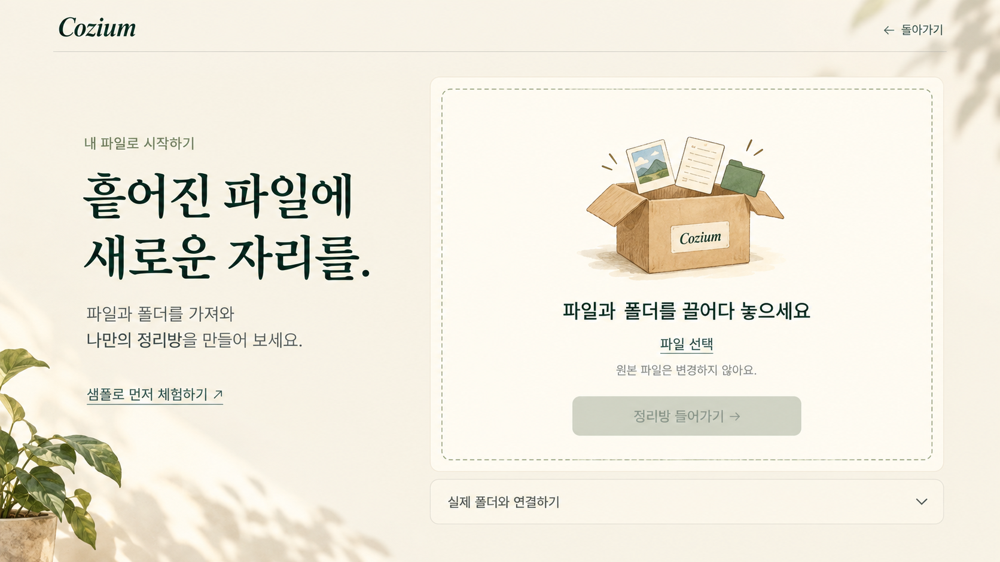

# Cozium의 디자인 이야기

Cozium은 흩어진 파일을 차가운 목록 대신, 아직 자리를 찾지 못한 물건으로 바라봅니다. 파일을 집고 상자에 담는 행동이 정리를 설명하도록 따뜻한 방, 종이, 크래프트 상자와 깊은 녹색을 중심으로 화면을 구성했습니다.

## 구현된 랜딩 (2026-10-07 교체)

랜딩은 글 설명 없이 앱이 하는 일을 보여 주는 짧은 여정입니다. 스크롤 한 번이 한 장면입니다.

1. **방:** 햇빛이 들어오는 방, 책상 위 노트북.
2. **바탕화면:** 노트북 화면으로 들어가면 파일 아이콘이 가득한 바탕화면이 화면을 채웁니다.
3. **물건과 상자:** 바탕화면이 눕혀져 방바닥이 되고, 파일 아이콘은 종류별로 모인 물건이, 폴더는 벽 수납장의 상자가 됩니다. 파일이 3D 공간에 덩어리로 놓이는 실제 앱의 모습입니다.
4. **직접 담기:** 더미를 누르면 통째로 손에 모이고, 상자를 누르면 들어갑니다. 더미 네 개를 모두 옮기면 바닥이 드러납니다. 자동으로 분류해 주는 장면은 없습니다.
5. **정리된 바탕화면:** 상자는 다시 폴더가 되고, 바탕화면에는 개수가 붙은 폴더 네 개만 남습니다.
6. **제자리를 찾은 방:** 같은 구도의 정돈된 방으로 나와 제목과 두 시작 버튼이 나타납니다.

이전 랜딩(이삿짐 상자 낙하·테이프·바탕화면 수거)은 `landing-classic.html`에 보관했습니다.

**내 파일로 시작하기**는 `app.html?entry=files`의 가져오기 화면으로, **체험해 보기**는 `app.html?entry=sample&storage=memory`의 샘플 3D 정리방으로 이어집니다. 랜딩의 아이콘은 연출용이며 실제 파일과 연결되지 않습니다.

첫 장면과 마지막 장면은 같은 방과 카메라 구도를 공유합니다. 정리하기 전후의 감각을 새로운 장소가 아닌 익숙한 장소의 변화로 보여주려는 구성입니다.

## 표현 방식

방은 1672×941 기준의 배경과 투명 전경 파츠를 겹친 원화이고, 노트북 화면 위의 바탕화면은 SVG를 원근에 맞춰 붙입니다. 바닥·물건·수납장·상자 장면은 Three.js로 그리며, 위에서 내려다본 카메라가 원화와 같은 크기로 맞물려 바탕화면이 그대로 바닥이 됩니다. 이전 랜딩은 Canvas 2D 합성이었습니다.

파일 정리 앱은 별도의 Three.js 3D 장면을 사용합니다. 실제 파일 이름과 상태를 카드로 표현하고 폴더를 목적지 상자로 표시합니다. 웹·샘플·Helper의 파일 처리 차이는 Provider에 두어 같은 정리 조작을 공유합니다.

원화의 따뜻한 종이색과 녹색, 낮고 넓은 이삿짐 상자, Fraunces 제목 서체를 화면의 기준으로 삼았습니다. `prefers-reduced-motion`에서는 카메라 이동 없이 장면이 바뀌고, 직접 담기는 Enter로 시연을 재생할 수 있습니다. 전체 접근성이나 실제 모바일 기기 검수를 완료했다는 뜻은 아닙니다.

## 파일 가져오기 화면의 다음 방향

현재 `app.html`은 기존의 웹 드롭·Helper 연결 UI를 사용합니다. 랜딩의 마지막 장면에서 가져오기 화면으로 넘어갈 때 시각적 톤을 이어 주는 재설계가 다음 작업입니다.

위 이미지는 이미지 생성으로 만든 **미구현 시안**입니다. 클릭 가능한 웹 화면이나 현재 앱의 캡처가 아닙니다. 가져오기 영역, 샘플 시작, 실제 파일 반영에 필요한 Helper의 역할을 한 화면에서 이해할 수 있도록 다듬는 참고 자료입니다. 구체적인 구성과 문구는 구현 단계에서 확정해야 합니다.

## 에셋 제작과 기록

| 에셋 | 현재 위치 | 제작·출처 |
| --- | --- | --- |
| 방 배경·전경 | `assets/landing/parts/room-v3/` | 이미지 생성 후 편집·투명 파츠 추출 |
| 상자·테이프 연출 | `assets/landing/box/` | 이미지와 Canvas 연출용 파츠 |
| 샘플 바탕화면 | `assets/landing/parts/desktop-v2/` | 프로젝트의 SVG 생성 코드 |
| Fraunces | `assets/landing/fonts/` | Fraunces Project Authors, SIL OFL 1.1 |
| 정리 앱의 3D 렌더러 | `vendor/three/` | Three.js authors, MIT |

방 파츠는 [room-v3 README](../assets/landing/parts/room-v3/README.md), 샘플 바탕화면은 [desktop-v2 README](../assets/landing/parts/desktop-v2/README.md)에 규격과 제작 기록이 있습니다. 각 에셋 폴더의 manifest·프롬프트 기록도 함께 보존합니다. 과거 시안·검수 캡처·작업 백업은 현재 구현과 구분해 로컬 `_archive/`에 남깁니다.

